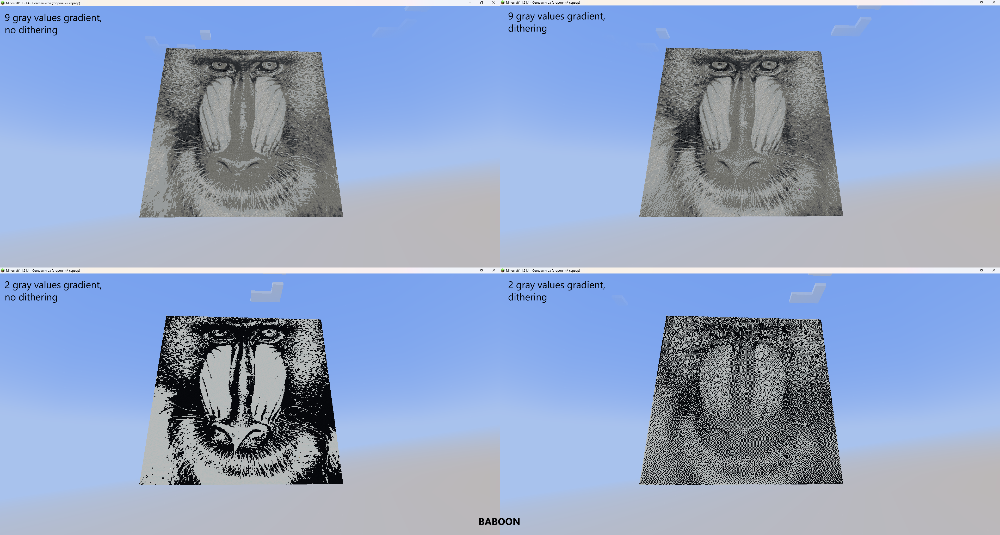

# MIMP

i.e. Minecraft Image Manipulation Program

Dump and Raw server-side program for minecraft 1.21.4 based on MSB3 a Minestom extension by @ScarletRedMan.

It can draw images from ```./src/run/images/``` in a Minecraft empty world using **display blocks** by rescaling and switching to grayscale palette.

- Just by typing anything in chat it will switch to another picture from the queue created at the start of the server.
- By typing ```dithering``` it will switch on/off and (remember it) dithering algorithm and redraw the image with 9 values grayscale palette.
- By typing ```binary``` it will redraw the same image with binary (black and white) palette
-By typing ```reload``` it will redraw the same image with 9 values grayscale palette.
